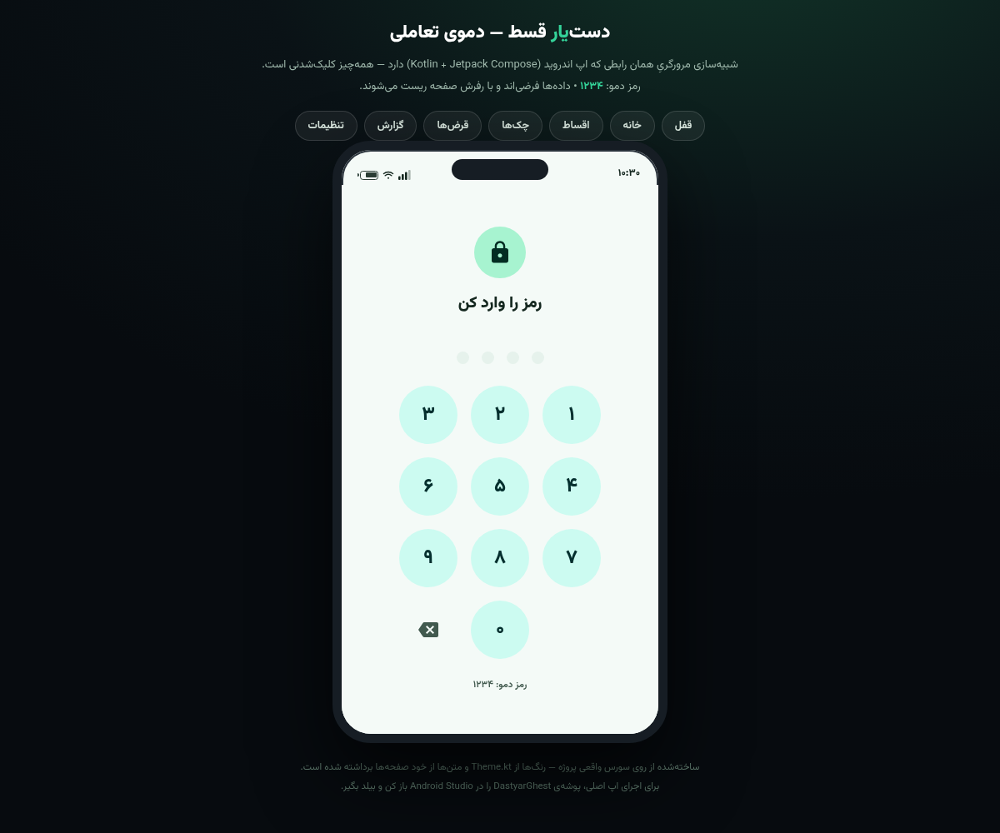
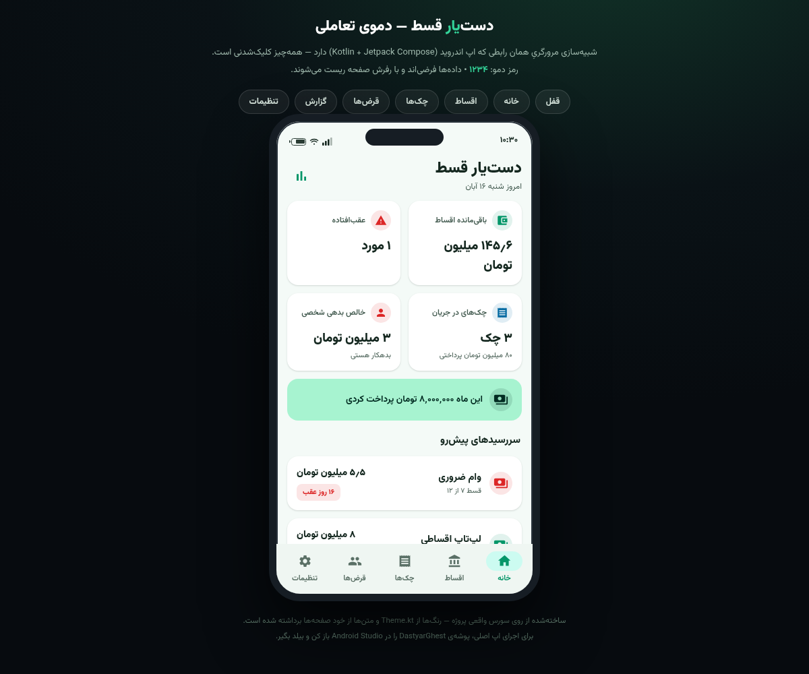
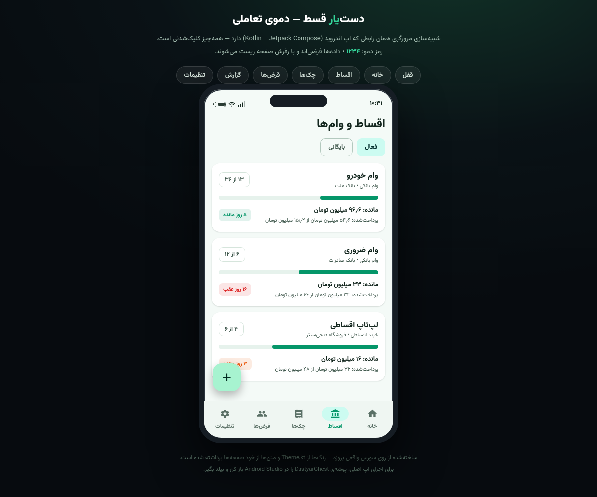
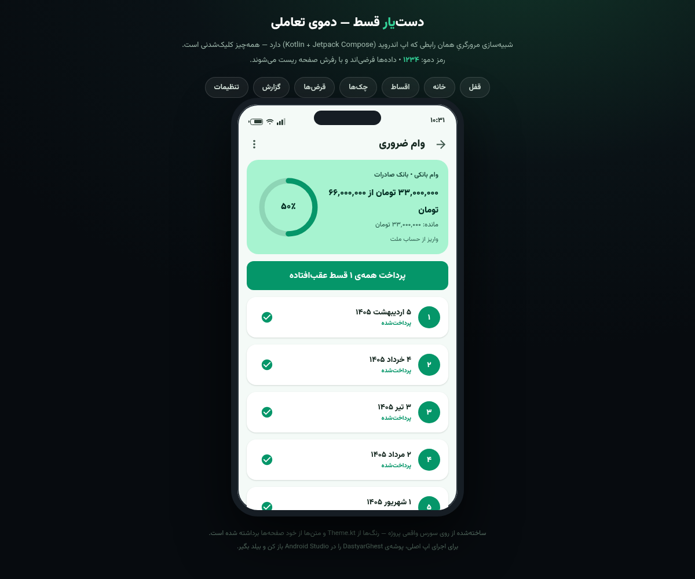
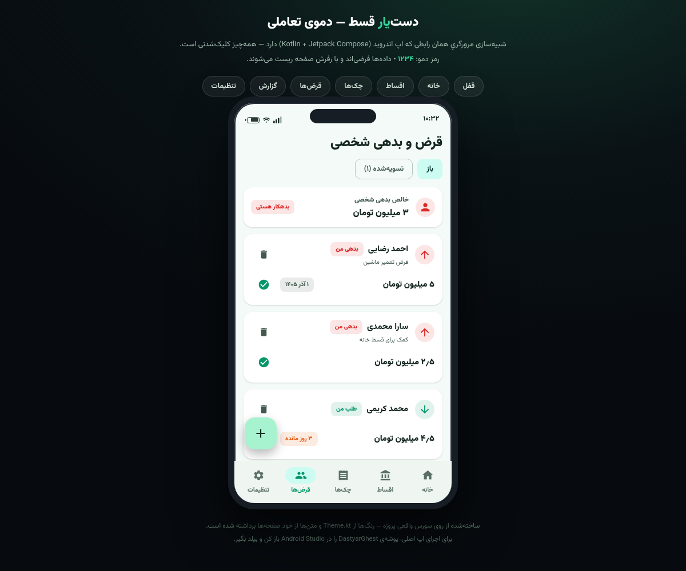
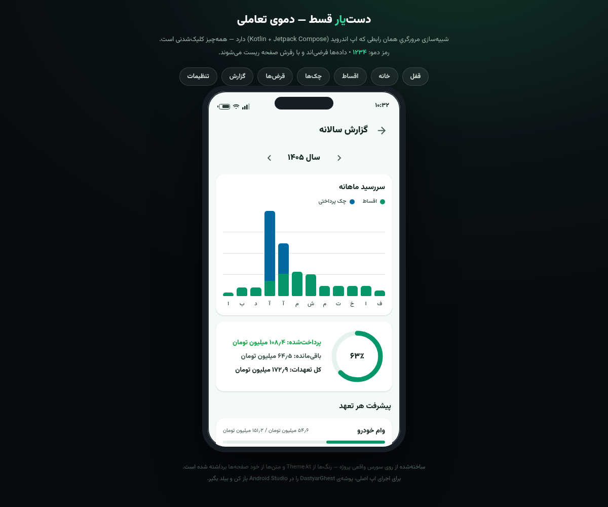
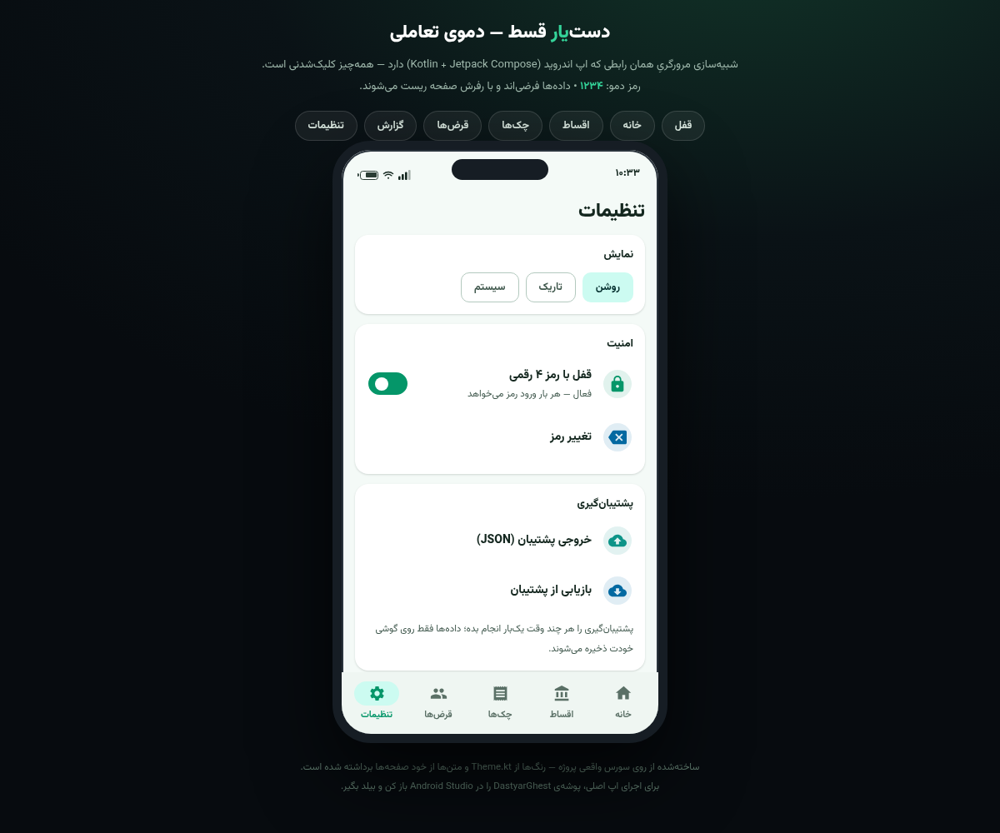
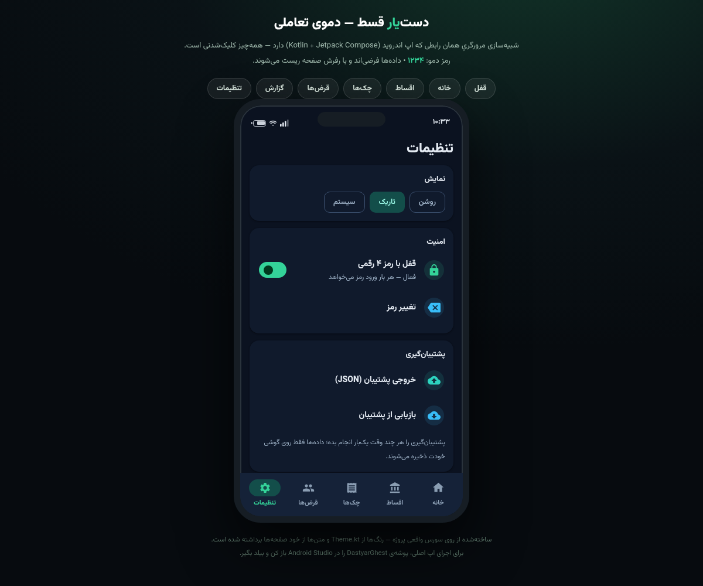

<div dir="rtl">

# دست‌یار قسط (Dastyar Ghest) — نسخه ۱.۱.۰

اپلیکیشن اندروید مدیریت اقساط، وام، چک و قرض شخصی — کاملاً آفلاین، فارسی و تقویم شمسی.

> بخشی از مجموعه اپلیکیشن‌های کاربردی **«دست‌یار»** — هر ابزار یک کار را ساده و بی‌دردسر انجام می‌دهد.

---

## 📸 اسکرین‌شات‌ها

| قفل PIN | داشبورد | وام‌ها |
|:---:|:---:|:---:|
|  |  |  |

| جزئیات وام | چک‌ها | بدهی شخصی |
|:---:|:---:|:---:|
|  |  |  |

| گزارش سالانه | تنظیمات | تم تاریک |
|:---:|:---:|:---:|
|  |  |  |

---

## 🌐 دموی تحت وب

نسخه وب کاملاً self-contained اپ در مسیر [`docs/index.html`](docs/index.html) قرار دارد — فایل را دانلود کن و مستقیم در مرورگر باز کن (بدون نیاز به اینترنت).

برای دسترسی آنلاین رایگان، می‌توانی **GitHub Pages** را فعال کنی:

`Settings → Pages → Source: Deploy from a branch → Branch: main / Folder: /docs → Save`

سپس دمو در آدرس `https://USERNAME.github.io/dastyar-ghest/` در دسترس می‌شود.

---

## 🚀 ساخت APK بدون نصب Android Studio (با GitHub Actions)

این ریپو یک workflow آماده دارد که خودِ گیت‌هاب اپ را بیلد می‌کند و فایل APK را به تو می‌دهد:

1. فایل APK بساز (دو راه):
   - بعد از هر push به `main` بیلد **خودکار** اجرا می‌شود؛ یا
   - برو به تب **Actions → Build APK → Run workflow → Run**
2. چند دقیقه صبر کن (بیلد اول ۵ تا ۸ دقیقه طول می‌کشد، دفعات بعد سریع‌تر است).
3. در صفحه اجرای بیلد، پایین بخش **Artifacts** فایل `DastyarGhest-APKs` را دانلود کن.
4. داخل فایل ZIP دانلودی دو APK هست:
   - **`DastyarGhest-debug-installable.apk`** → همین را روی گوشی نصب کن و اپ را تست کن ✅
   - **`DastyarGhest-release-unsigned.apk`** → برای انتشار در مایکت باید با keystore خودت امضا شود (در Android Studio).

> ⚠️ فایل‌های Artifact فقط با ورود به حساب گیت‌هاب قابل دانلودند و تا ۳۰ روز نگه‌داری می‌شوند.

### ساخت نسخه امضاشده برای مایکت

خروجی CI امضا نشده است. دو راه داری:

- **راه ساده:** `DastyarGhest-release-unsigned.apk` را با Android Studio امضا کن؟ — نه؛ امضا فقط از سورس انجام می‌شود. پس در Android Studio: `Build → Generate Signed Bundle / APK → APK` با keystore خودت.
- **راه حرفه‌ای (اختیاری):** keystore را Base64 کن و به‌عنوان GitHub Secret ذخیره کن تا CI هم APK امضاشده بدهد. اگر خواستی، مراحلش را برایت آماده می‌کنم.

---

## 💻 ساخت با Android Studio

1. پروژه را با **Android Studio Koala یا جدیدتر** باز کن و صبر کن Sync تمام شود.
2. تست سریع: `Build → Build Bundle(s) / APK(s) → Build APK(s)` — خروجی debug در `app/build/outputs/apk/debug/`.
3. انتشار در مایکت: `Build → Generate Signed Bundle / APK → APK` با keystore خودت — **keystore و رمزش را برای همیشه نگه دار؛ بدون آن آپدیت ممکن نیست.**

---

## ✨ امکانات

- **داشبورد:** باقی‌مانده اقساط، عقب‌افتاده‌ها، چک‌های در جریان، خالص بدهی شخصی، پرداخت این ماه و سررسیدهای ۴۵ روز آینده با رنگ‌بندی فوریت
- **وام/اقساط:** ثبت وام بانکی، قرض‌الحسنه، خرید اقساطی، بیمه و اجاره با تولید خودکار اقساط، نوار پیشرفت، بایگانی، پرداخت تکی یا همه‌ی عقب‌افتاده‌ها
- **چک:** دریافتی/پرداختی، شماره و شناسه صیادی، وضعیت (در جریان/پاس‌شده/برگشتی/ابطال) و فیلتر وضعیت
- **قرض شخصی:** بدهکارم/طلب دارم، تسویه و بازگردانی، خالص بدهی در داشبورد
- **گزارش سالانه:** نمودار میله‌ای سررسید ماهانه (اقساط + چک)، حلقه درصد پرداخت، پیشرفت هر تعهد
- **یادآور نوتیفیکیشن:** روزانه ساعت ۸ صبح؛ اقساط، چک‌ها و بدهی‌های ۳ روز آینده + عقب‌افتاده‌ها
- **قفل رمز ۴ رقمی** (هش SHA-256)
- **پشتیبان‌گیری:** خروجی/ورودی JSON کامل + خروجی CSV سازگار با اکسل
- **تم روشن/تاریک/سیستم**، رابط کاملاً راست‌به‌چپ با اعداد فارسی
- **عکس مدرک [جدید ۱.۱.۰]:** عکس‌برداری از چک/برگه‌ی اقساط و نگه‌داری در جزئیات وام — بدون مجوز دوربین، کاملاً آفلاین
- **ویرایش [جدید ۱.۱.۰]:** ویرایش مشخصات وام (تغییر مبلغ روی اقساط پرداخت‌نشده هم اعمال می‌شود) + ویرایش تاریخ/مبلغ هر قسط
- **ورود سریع [جدید ۱.۱.۰]:** چیپ‌های آماده‌ی تعداد قسط (۶/۱۲/۱۸/۲۴/۳۶) و دکمه‌ی «همین امروز» — حداقل تایپ
- **پشتیبانی [جدید ۱.۱.۰]:** دکمه‌ی تماس با پشتیبانی در تنظیمات + بیانیه‌ی حریم خصوصی

## 🔧 مشخصات فنی

| مورد | مقدار |
|---|---|
| زبان | Kotlin 2.0 + Jetpack Compose (Material 3) |
| پکیج | `ir.dastyar.ghest` |
| حداقل اندروید | 7 (API 24) |
| هدف | Android 14 (API 34) — منطبق بر الزام مایکت |
| دیتابیس | Room (کاملاً آفلاین) |
| یادآور | WorkManager — روزانه ساعت ۸ صبح |
| تقویم | شمسی (الگوریتم jalaali تست‌شده) |
| نسخه | 1.1.0 (versionCode 3) |
| Gradle | 8.7 — AGP 8.5.2 — JDK 17 |

## 🗂 ساختار پروژه

```
app/src/main/java/ir/dastyar/ghest/
├── GhestApplication.kt      ← زمان‌بندی یادآور
├── GhestApp.kt              ← تم + قفل + ناوبری
├── MainActivity.kt
├── backup/Backup.kt         ← JSON/CSV
├── data/                    ← Room: Models, Daos, Db
├── notify/ReminderWorker.kt ← نوتیفیکیشن روزانه
├── ui/components/Ui.kt      ← کامپوننت‌ها + انتخابگر تاریخ شمسی
├── ui/screens/              ← ۸ صفحه اصلی
├── ui/theme/Theme.kt        ← پالت سبز مالی
├── util/Jalali.kt           ← تقویم شمسی (تست‌شده)
├── util/Format.kt           ← اعداد فارسی و پول
└── viewmodel/               ← Dashboard/Loans/Checks/Debts/Reports/Settings
```

## 🛡 نکات امنیتی ریپو

- `.gitignore` طوری تنظیم شده که فایل‌های `*.jks` و `*.keystore` و `local.properties` هرگز به گیت‌هاب راه پیدا نکنند — امضای اپت را هرگز کامیت نکن.
- پیشنهاد: ریپو را **Private** بساز؛ GitHub Actions برای ریپوی خصوصی هم رایگان است (۲۰۰۰ دقیقه در ماه — برای این پروژه یعنی ده‌ها بیلد).

---

## انتشار در مایکت

- [ ] APK release امضاشده بساز (از CI یا Android Studio)
- [ ] آیکون اختصاصی ۵۱۲×۵۱۲
- [ ] حداقل ۲–۶ اسکرین‌شات از داخل اپ (پوشه `screenshots/` نقطه شروع خوبی است)
- [ ] عنوان: «دست‌یار قسط» + توضیحات کامل بدون صفت عالی
- [ ] تغییرات نسخه اجباری فرم پنل را پر کن
- [ ] ایمیل تماس در پنل
- [ ] ارسال برای بررسی (حداکثر ۳ روز کاری)

</div>

---

## English Summary

**Dastyar Ghest** (Loan & Installment Assistant) — a fully offline, Persian/RTL Android app for managing bank loans, installments, post-dated checks and personal debts, built with Kotlin 2.0 + Jetpack Compose (Material 3), Room, WorkManager and the Jalali calendar.

- **Build in the cloud:** push to `main` (or run the *Build APK* workflow manually) → GitHub Actions builds both debug and release APKs → download from the run's Artifacts.
- **Build locally:** open in Android Studio and sync; generate a signed APK for publishing.
- **Web demo:** self-contained single-file demo at `docs/index.html` — works offline, or serve via GitHub Pages from the `/docs` folder.
- Package: `ir.dastyar.ghest` · minSdk 24 · targetSdk 34 · version 1.0.1
